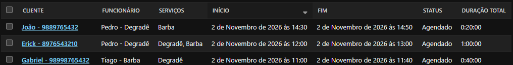
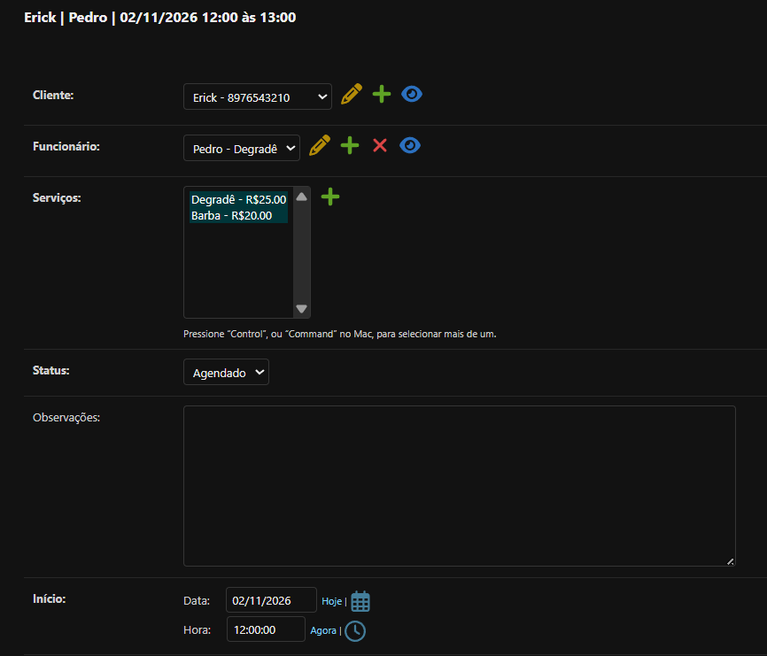
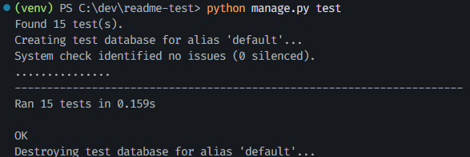

# Barber Manager

Sistema web de gestão de barbearia, feito em Django, criado por um barbeiro para resolver problemas reais do dia a dia: agenda sem horários conflitantes, cadastros de clientes e controle dos serviços.

> 🚧 **Em desenvolvimento.** A regra principal da agenda já está pronta e testada; as telas e o login são as próximas etapas.



## Status do projeto

- [x] Cadastro de clientes, barbeiros e serviços (pelo painel admin)
- [x] Agendamento com duração calculada automaticamente a partir dos serviços escolhidos
- [x] Regra de conflito de horário implementada e testada (ainda não conectada às telas)
- [x] Suíte de testes automatizados
- [ ] Mudança de status do atendimento (agendar, concluir, cancelar)
- [ ] Telas para o dia a dia (agenda do dia, formulários)
- [ ] Login e permissões (cliente, barbeiro e administrador)
- [ ] Relatórios e faturamento

## Regras de negócio

**Já implementadas**

- Cada agendamento reserva **10 minutos de intervalo** depois do término, e esse intervalo conta para conflito.
- Só os agendamentos com status **agendado** entram na comparação de conflito. Concluídos e cancelados não bloqueiam a agenda.
- A duração do agendamento é a soma da duração dos serviços escolhidos.
- A função de conflito detecta sobreposição entre atendimentos do **mesmo barbeiro**; barbeiros diferentes não se afetam. Por enquanto ela ainda não impede o salvamento pelo painel: isso vem com as telas.

**Planejadas (a implementar)**

- Concluído e cancelado serão estados finais, sem poder alterar horário nem serviços.



## Tecnologias

- Python 3.13
- Django 6.0.5
- SQLite
- python-dotenv

## Como rodar

### Pré-requisitos

- Python 3.13
- Git

### Passo a passo

1. Clone o repositório e entre na pasta:

```bash
git clone https://github.com/Raelsons10/gerenciador_de_barbearia.git
cd gerenciador_de_barbearia
```

2. Crie e ative o ambiente virtual:

```powershell
# Windows (powershell)
python -m venv venv
.\venv\Scripts\Activate.ps1
```

```bash
# Linux / macOS
python3 -m venv venv
source venv/bin/activate
```

3. Instale as dependências:

```bash
python -m pip install -r requirements.txt
```

4. Crie o arquivo `.env` na raiz do projeto (ao lado do `manage.py`) com o seguinte conteúdo:

```dotenv
SECRET_KEY=sua-chave-aqui
DEBUG=True
```

Para gerar uma chave:

```bash
python -c "from django.core.management.utils import get_random_secret_key; print(get_random_secret_key())"
```

> O `.env` não vai para o Git (está no `.gitignore`). Sem a `SECRET_KEY`, o projeto não inicia, de propósito.

5. Crie o banco de dados e um usuário administrador:

```bash
python manage.py migrate
python manage.py createsuperuser
```

6. Inicie o servidor e acesse o painel em http://127.0.0.1:8000/admin:

```bash
python manage.py runserver
```

## Testes

```bash
python manage.py test
```



Os testes cobrem a regra de conflito de horário (agenda vazia, sobreposição, intervalo de 10 minutos, outro barbeiro, status cancelado e concluído, edição de agendamento existente) e o cálculo de duração.

## Solução de problemas

**`KeyError: 'SECRET_KEY'`**: o arquivo `.env` não existe ou está na pasta errada. Ele precisa ficar na raiz, ao lado de `manage.py`.

**O PowerShell não ativa o ambiente virtual**: libere a execução de scripts na sessão com `Set-ExecutionPolicy -Scope Process -ExecutionPolicy RemoteSigned` e tente de novo.

## O que o projeto me ensinou

Criei o Barber Manager para resolver um problema real do meu dia a dia como barbeiro e, ao mesmo tempo, consolidar meus conhecimentos em programação aplicada a regras de negócio.

Neste projeto pratiquei:

- **Testes automatizados e TDD:** escrevo o teste primeiro, vejo falhar e só então faço passar. Também quebro a regra de propósito para confirmar que o teste realmente a protege.
- **Regras de negócio em código:** transformei decisões reais da barbearia, como o intervalo de 10 minutos entre atendimentos e quais status bloqueiam a agenda, em uma regra de conflito de horário testada.
- **Git e GitHub:** trabalho com uma branch por funcionalidade, commits pequenos e Pull Requests para integrar na `main`.
- **Organização com Django:** separei o sistema em apps (clientes, funcionários, serviços e agendamentos) e documentei no código o porquê das decisões.

O projeto segue em evolução: as próximas etapas são as telas e o login, e cada uma delas vem com novos conceitos para aprender.

## Autor

**Raelson Santos** · [LinkedIn](https://www.linkedin.com/in/raelson-santos-179758305) · [E-mail](mailto:raelsons45@gmail.com)
